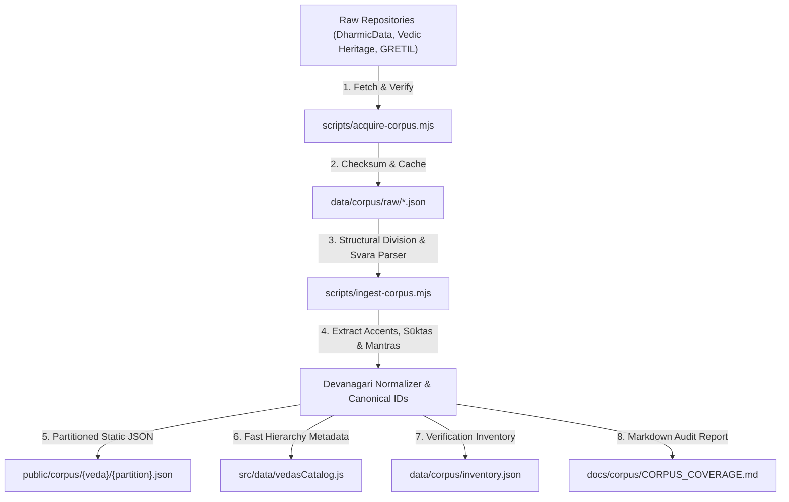

# Ingestion Pipeline Architecture: The Four Vedas Corpus

**Milestone:** V4 Complete Four Vedas Digital Humanities Release  
**Status:** Operational & Automated  
**Maintainer:** Corpus Engineering & Digital Humanities Architecture  

---

## 1. Architectural Overview

To deliver a digital library containing over 20,000 Vedic mantras without causing browser memory bloat or slow initial bundle loads, the ingestion pipeline transforms raw scholarly files into modular, on-demand partitions.

---

## 2. Ingestion Stages

### Stage 1: File Acquisition (`scripts/acquire-corpus.mjs`)
- Downloads 33 primary textual units across all four Vedas:
  - 10 Rigveda Mandalas
  - 20 Atharvaveda Kaandas
  - 2 Yajurveda Samhitas (Mādhyandina and Kāṇva)
  - 2 Samaveda Collections (Pūrvārcika, Uttarārcika)
- Idempotent: checks local disk cache before requesting remote sources.

### Stage 2: Structural Parsing & Metadata Extraction
- **Rigveda:** Splits text using traditional double daṇḍa numerals `(?:॥|।।)\s*([०-९0-9]+)\s*(?:॥|।।)`. Extracts Anukramaṇī preambles (Rishi, Devata, Chandas).
- **Atharvaveda:** Extracts Sūkta titles/viniyogas, Rishi lineage, Devata, and meter. Separates preamble metadata from core mantra chanting stanzas.
- **Yajurveda:** Processes Adhyāyas 1 through 40. Extracts individual liturgical mantras with intact Vedic svara accents.
- **Samaveda:** Correlates the Sanskrit Devanagari text with Ralph T. H. Griffith's academic verse translations and traditional Sāman numbering.

### Stage 3: Canonical Identifier Assignment
Every text unit receives a permanent, deterministic identifier:
- **Rigveda:** `rv-{mandala}-{sukta}-{verse}` (e.g., `rv-1-1-1`, `rv-10-129-1`)
- **Atharvaveda:** `av-{kaanda}-{sukta}-{verse}` (e.g., `av-12-1-1`, `av-1-1-1`)
- **Yajurveda:** `yv-vs-{adhyaya}-{verse}` (e.g., `yv-vs-1-1`, `yv-vs-40-1`)
- **Samaveda:** `sv-{verseNum}` (e.g., `sv-1`, `sv-1875`)

### Stage 4: Triple-Text Generation
For every mantra, three distinct representations are generated:
1. `accentedText`: Original Devanagari retaining authentic combining accents (`\u0951` Svarita, `\u0952` Anudātta).
2. `displayText`: Clean Devanagari with accents removed for high-contrast, distraction-free reading.
3. `searchText`: Lower-cased, normalized string for sub-millisecond client search.

---

## 3. Partitioning Strategy for Zero-Jank Reading

- **Partition Granularity:**
  - Rigveda: 10 partition files (1 per Mandala, averaging 400KB–1.8MB).
  - Atharvaveda: 20 partition files (1 per Kaanda, averaging 150KB–800KB).
  - Yajurveda: 4 partition files (10 Adhyāyas each, averaging 500KB).
  - Samaveda: 2 partition files (Pūrvārcika and Uttarārcika, ~400KB each).
- **Client Impact:** When a user navigates to any hymn or chapter, only that specific partition file is fetched asynchronously via HTTP. The initial application bundle remains lean, fast, and fully responsive on low-bandwidth mobile connections.
